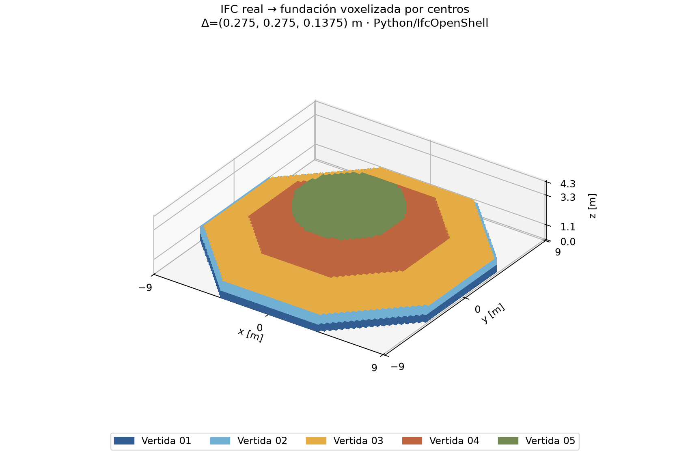

> **Importación para GitHub · 4 de noviembre de 2026.** Esta carpeta procede de `P2_E07.zip`. Los estados de publicación del texto original son históricos. Consultar [la constancia de importación y verificación](docs/PUBLICACION_GITHUB_E07.md).

# MCOC · Proyecto 2 · Grupo 2 · E07

**Voxelización, vertidas e hidratación — revisión oral del 4 de noviembre de 2026,
10:30–13:20, 4 puntos.** Carpeta autónoma basada en una copia física de E06.
El código nuevo conecta el IFC real con una grilla 3D y un ensamblaje térmico
enmascarado; la temperatura transiente de la fundación aún no se integra.

Documentación: [formulación](docs/E07_FORMULACION.md),
[demostración y nueve respuestas orales](docs/E07_DEMO.md),
[estado](docs/E07_ESTADO.md) y [auditoría](docs/E07_AUDITORIA.md).

## Instalar sin red

Desde esta carpeta, Windows x64 y Python 3.12. Se comprobó CPython 3.12.10.
No se necesitan archivos de otras entregas. Las 24 ruedas y el lock se mantienen.

```powershell
py -3.12 -m venv .venv
$pyE07 = '.\.venv\Scripts\python.exe'
& $pyE07 -m pip install --no-index --find-links vendor/wheels -r requirements-lock.txt
& $pyE07 -m pip install --no-index --no-build-isolation --no-deps -e '.[dev,plot,bim]'
& $pyE07 -m pip check
```

El paquete es mcoc-p2 0.7.0. No se modificaron los solvers heredados.

## Demostración y verificación

```powershell
& $pyE07 -X utf8 -B examples/run_e07.py --inspect-only --output results/e07_inspeccion
& $pyE07 -X utf8 -B examples/run_e07.py --output results/e07_demo
& $pyE07 -X utf8 -B examples/run_e07.py --spacing 0.4 0.3 0.275 --margin 0.1 --interval-hours 3 --heat-mj-m3 40 --duration-hours 36 --h 15 --ambient 12 --output results/e07_modificado
& $pyE07 -X utf8 -B scripts/verify_e07.py --output results/e07_verificacion
& $pyE07 -X utf8 -B scripts/check_e07_independence.py --output evidencias/e07_independencia_nueva
```

Usar destinos nuevos; se rechaza sobrescribir resultados. La demostración
acepta JSON mediante --config y parámetros por CLI; lista completa y cambios
por vertida en E07_DEMO.md. El calendario y los parámetros de hidratación son
FICTICIOS, ilustrativos y sin calibración para Freirina.

```powershell
& $pyE07 -X utf8 -B -m pytest tests -q -p no:cacheprovider
& $pyE07 -X utf8 -B scripts/check_ifc.py geometry/foundation.ifc --json results/e07_ifc.json
```

verify_e07 repite todos los tests y la batería térmica heredada, verifica IFC,
corre dos demostraciones con parámetros distintos, tres resoluciones de volumen,
checks explícitos y cinco figuras por demostración. El script de independencia
crea una copia física externa y otro entorno usando exclusivamente sus ruedas.

## Datos y evidencia

- [Ejecución local vigente](evidencias/e07/verificacion_02/verification.json).
- [Resultados BIM–grilla](evidencias/e07/verificacion_02/demo/summary.json).
- [Autonomía](evidencias/e07_independencia/independence.json).
- [IFC real](geometry/foundation.ifc): cinco IfcFooting y propiedades de vertida.
- [Base E06 copiada](docs/E07_BASE_E06_INVENTARIO.json) y [enunciado E07](docs/E07_ENUNCIADO.md).

geometry.json/npz registra metadatos y mallas mundiales SI; voxels.npz contiene
occupation_mask, vertida_id, origen, pasos y coordenadas. faces.npz guarda
caras e interfaces; construction.npz conserva el estado de colocación,
capacidad activa, fuente y potencia instantánea. summary.json registra
volumen y error por vertida, superficies finales/activas, eventos, edades,
parámetros, tolerancias y checks. Los campos de colocación son estados de
estructura, no temperaturas de una simulación transiente resuelta.

## Figuras finales



Las figuras de [error volumétrico](figures/e07_error_volumen.png),
[superficies/interfaces](figures/e07_superficies_interfaces.png),
[activación](figures/e07_activacion_temporal.png) e
[hidratación](figures/e07_hidratacion_preliminar.png) se obtuvieron de datos reales
de la demo. La curva prescrita y el cronograma se marcan como preliminares.
Son visualizaciones Python/IfcOpenShell, no capturas de Bonsai.

## Alcance y conservación de antecedentes

El ensamblaje usa capacidad solo en celdas activas, contactos perfectos con
conductancias armónicas y fronteras en caras expuestas; las interfaces activas
son conductivas. Se comparó con el solver E06 en una máscara completa.
Falta el integrador transiente enmascarado y su balance de inserción térmica.
La hidratación prescrita depende de edad real y no de temperatura; no hay
Arrhenius, calibración, clima ni predicción final de Freirina.

El área staircase puede tener sesgo de orientación. Los errores de volumen
no tienen por qué disminuir monótonamente; el error total puede ocultar
compensación por vertida. Se guardan y discuten ambos.

E01–E06 permanecen intactas. La documentación y evidencia heredadas siguen
presentes y el README E06 está en docs/README_HEREDADO_E06.md. Sus inventarios
congelados son históricos; el verificador que corresponde a esta entrega es
verify_e07.py. Los validadores de un respaldo E06 estricto no se presentan como
inventarios del contenido ampliado de E07.

**COMMIT E06 PENDIENTE DE PUBLICACIÓN.** E07 tampoco se presenta como
repositorio publicado ni se identifica con un SHA E01. No se crearon commits,
ramas o PR ni se publicaron cambios. No se implementaron E08–E15.

El [inventario final SHA256](E07_INVENTARIO_SHA256.json) identifica los archivos
de esta entrega, excluyendo su propio contenido, entornos y cachés recreables.
No sustituye un identificador Git publicado.
