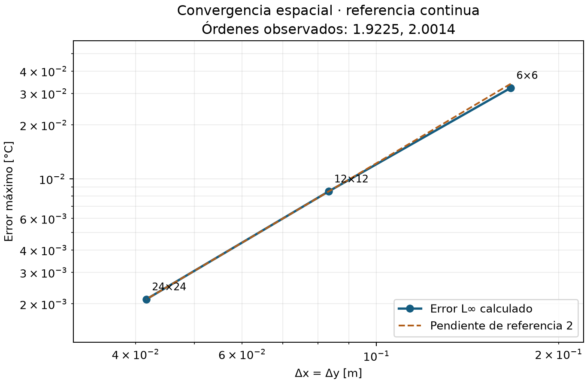
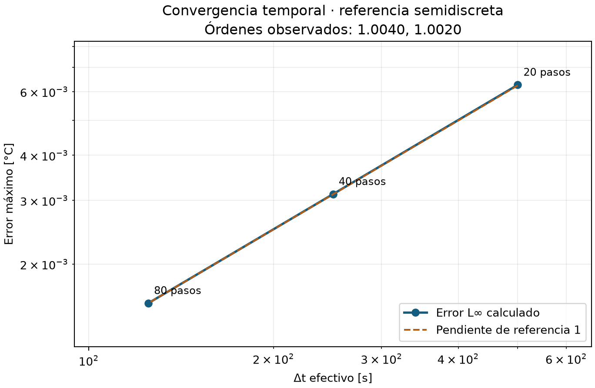
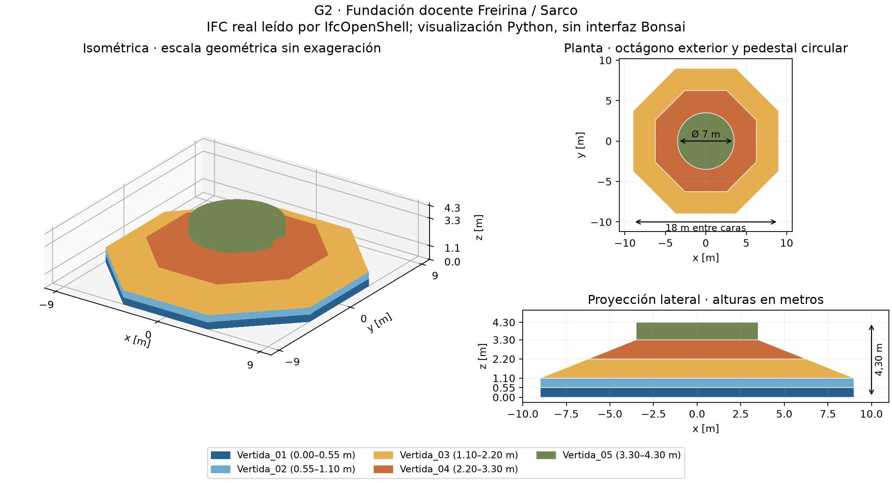

# E06 — Dossier de verificación y BIM del caso base

## Identificación y alcance

MCOC, Proyecto 2, Grupo 2: Freirina / Parque Eólico Sarco. Entrega del viernes
30 de octubre de 2026, sin actividad sincrónica, 3 puntos. Evidencia calculada
el 28 de octubre. El objetivo es congelar la verificación del solver básico y
documentar una versión coherente del BIM. Se conservaron físicamente los
archivos de E05 y se reconstruyó el entorno dentro de E06; los antecedentes
históricos permanecen separados de las nuevas ejecuciones.

El IFC representa la geometría constructiva. El solver trabaja sobre cajas
cartesianas ideales de verificación: todavía no existe integración mediante
voxelización. Por tanto, las temperaturas y energías siguientes no constituyen
una predicción térmica de la fundación de Freirina. No se incorporaron etapas
posteriores, hidratación ni condiciones climáticas transientes.

## Repositorio y commit

Repositorio: [amvaras/Proyecto-2-MCOC](https://github.com/amvaras/Proyecto-2-MCOC).
Commit evaluado: **COMMIT E06 PENDIENTE DE PUBLICACIÓN**.
La consulta remota encontró main en una entrega E01, sin dossier E06.
Ese antecedente no identifica estos archivos. No se crearon commits ni se
publicaron cambios. La integridad local queda identificada mediante SHA256;
el cierre formal exige publicar E06 y consignar su commit con autorización.

## Matriz de verificación

Cada enlace conduce a parámetros, referencias, métricas y tolerancias de una
ejecución nueva desde E06. PASS exige satisfacer todos los controles del caso.
La suite completa aprobó **198 pruebas**, sin fallos, errores ni omisiones;
también aprobaron diez casos nominales y sesenta variantes. Los rechazos
deliberados de estabilidad, unidades y precisión se comprobaron por motivo y
código de salida, sin contarlos como fallos inesperados de pytest.

| Test | Qué verifica | Error/métrica | Resultado |
|---|---|---|---|
| [Exacta 1D](../evidencias/e06/ejecucion_02/thermal/battery/exact_1d/summary.json) | Seno continuo, centros y caras | L∞=0.0006707491 °C ≤ 0,03 °C | PASS |
| [Exacta 2D](../evidencias/e06/ejecucion_02/thermal/battery/exact_2d/summary.json) | Seno continuo, centros y caras | L∞=0.00121382 °C ≤ 0,03 °C | PASS |
| [Exacta 3D](../evidencias/e06/ejecucion_02/thermal/battery/exact_3d/summary.json) | Seno continuo, centros y caras | L∞=0.002314446 °C ≤ 0,03 °C | PASS |
| [Convergencia espacial](../evidencias/e06/ejecucion_02/thermal/battery/spatial/summary.json) | Referencia continua; Δt fijo | p=1.92254/2.00140; 2±0,30 | PASS |
| [Convergencia temporal](../evidencias/e06/ejecucion_02/thermal/battery/temporal/summary.json) | Referencia semidiscreta; malla fija | p=1.00403/1.00201; 1±0,15 | PASS |
| [Conservación adiabática](../evidencias/e06/ejecucion_02/thermal/battery/energy/summary.json) | Capacidad heterogénea ponderada | residuo 4.479e-10 J ≤ 3.085e-04 J | PASS |
| [Fuente uniforme](../evidencias/e06/ejecucion_02/thermal/battery/source/summary.json) | Ley lineal y energía generada | L∞=2.487e-14 °C ≤ 2,463e-10 °C | PASS |
| [Neumann](../evidencias/e06/ejecucion_02/thermal/battery/neumann/summary.json) | Flujo × área y signo saliente | residuo 3.609e-09 J ≤ 2.555e-04 J | PASS |
| [Robin](../evidencias/e06/ejecucion_02/thermal/battery/robin/summary.json) | Media celda, película y balance | residuo 5.588e-09 J ≤ 5.401e-04 J | PASS |
| [Estabilidad](../evidencias/e06/ejecucion_02/thermal/battery/stability/summary.json) | Monotonía y rechazo de exceso | 0,99·límite aceptado; 1,01 rechazado; exceso ≤ 1e-10 °C | PASS |

La referencia continua es
$$T=T_0+A\prod_j\sin(\pi x_j/L_j)\exp[-\alpha\sum_j(\pi/L_j)^2t],\qquad\alpha=k/(\rho c_p).$$
Se evalúa en centros físicos; las caras mantienen Dirichlet T₀. Sustituirla
en la ecuación confirma la referencia sin recurrir a resultados del solver.
L∞ es el máximo error puntual. El balance suma capacidades por temperatura;
las potencias internas se cancelan y los flujos externos positivos extraen
energía. Los criterios se fijaron antes de observar las nuevas corridas.

## Convergencia espacial

Caja bidimensional de 1×1 m, k=2 W/(m·K), ρ=2400 kg/m³, cₚ=900 J/(kg·K),
T₀=20 °C, A=10 °C y tiempo final 10000 s. Se empleó Δt=3,125 s en las tres
mallas. El error temporal, medido contra el modo semidiscreto, representa
como máximo 2.036% del error total, inferior al límite previo del 10%.

| Celdas | Δx [m] | L∞ [°C] | Componente temporal [°C] |
|---|---:|---:|---:|
| 6×6 | 0.16666667 | 0.032183990 | 3.891e-05 |
| 12×12 | 0.08333333 | 0.008489825 | 4.230e-05 |
| 24×24 | 0.04166667 | 0.002120399 | 4.318e-05 |

Los cocientes son 3.79089 y 4.00388. El orden observado se
aproxima a dos; la malla gruesa aún presenta efectos preasintóticos.
La recta auxiliar de la figura ilustra pendiente, sin ajustar ni ocultar puntos.

Figura 1. Refinamiento espacial con referencia continua y paso temporal fijo.

## Convergencia temporal

Se mantuvo la malla 6×6 y las mismas propiedades. Para aislar el error de Euler
se comparó con el modo exacto del sistema espacial discretizado, cuyo
decaimiento es αΣⱼ4sin²(π/(2nⱼ))/Δxⱼ². Este autovalor se contrastó también
contra el operador real. No se mezcló refinamiento temporal con espacial.

| Δt efectivo [s] | Pasos | L∞ [°C] |
|---|---:|---:|
| 500.000000 | 20 | 0.006260256 |
| 250.000000 | 40 | 0.003121399 |
| 125.000000 | 80 | 0.001558527 |

Los cocientes 2.00559 y 2.00279 y los órdenes de la matriz
confirman primer orden temporal en este régimen. Todos los pasos satisfacen
la cota local de monotonía, calculada con capacidades y conductancias.

Figura 2. Malla fija y comparación semidiscreta; pendiente esperada igual a uno.

## Conservación de energía

La caja 3D adiabática utiliza un perfil cosenoidal no uniforme, fuente cero y
dos regiones materiales. En la segunda mitad se multiplican k, ρ y cₚ por
3, 1,15 y 0,8. Se calcula E=ΣᵢρᵢcₚᵢVᵢ(Tᵢ−20 °C), evitando medias sin
ponderación. El cambio final es 3.241e-10 J y el residuo máximo figura en
la matriz. El rango térmico disminuye de 19.49107 a 14.82510 °C: hay redistribución
interna sin creación de energía. La tolerancia combina 1e-7 J y 5e-12 de una
escala energética definida por capacidad, temperaturas y generación.

## Fuente volumétrica uniforme

Con inicial uniforme de 20 °C, aislamiento, q̇=1000 W/m³, V=1 m³ y las
propiedades anteriores, T(t)=T₀+q̇t/(ρcₚ). A 10000 s, el incremento esperado
es 4,629629630 °C y el calculado es 4.629629630 °C.
La energía esperada es 10000000 J; la calculada es 10000000.00000005 J.
Se verificaron temperatura y balance en todos los tiempos guardados.
La fuente es volumétrica; un flujo Neumann se expresa por unidad de superficie.

## Robin

El caso 3D parte de 50 °C, con ambiente a 20 °C y h=12 W/(m²·K) en sus seis
caras. Se usa R″=Δn/(2k)+1/h y q″=(T_celda−T_ambiente)/R″.
La resistencia de media celda evita identificar temperatura central con
superficial; esta última tampoco tiene que coincidir con el ambiente.
El flujo inicial sale del sólido y el enfriamiento pierde
13455099.41544 J. Se comprobaron ambas resistencias, ley superficial,
principio máximo y balance integrado usando el estado previo de Euler.
Una ejecución adicional con h=25 también aprobó; no se presenta la curva
numérica como solución analítica exacta del problema Robin general.

## BIM base

El [IFC incluido](../geometry/foundation.ifc) es IFC4, en metros, con cinco
IfcFooting identificables. Se validaron esquema, jerarquía, propiedades,
orientación, mallas cerradas y diez pares sin solapamiento volumétrico.
Las cotas reales confirman octágono exterior de 18 m entre caras, borde de
1,10 m, centro de 3,30 m y pedestal circular Ø7 m con 1,00 m adicional:
altura global 4,30 m. Las coordenadas climáticas docentes son
−28.856102, −71.421831; el IFC utiliza origen local sin georreferenciación.

| Elemento | Intervalo z [m] | Volumen analítico [m³] |
|---|---:|---:|
| Vertida_01 | 0.00–0.55 | 147.62571 |
| Vertida_02 | 0.55–1.10 | 147.62571 |
| Vertida_03 | 1.10–2.20 | 214.22435 |
| Vertida_04 | 2.20–3.30 | 88.92475 |
| Vertida_05 | 3.30–4.30 | 38.48451 |

El volumen exacto de perfiles y troncos es 636.88504 m³, coherente con
636,89 m³. La malla triangular arroja 636.87772 m³; la pequeña diferencia
proviene de teselar el círculo. La tolerancia relativa por pieza es 5e-4.

Figura 3. Geometría leída del IFC mediante IfcOpenShell y dibujada en Python;
no es una captura de Bonsai. Colores identifican vertidas y cotas globales.

## Simplificaciones geométricas

- Octágono idealizado respecto de la fundación que inspira la guía docente.
- Borde de 1,10 m adoptado para el ejercicio, no medido directamente del paper.
- Transición inclinada mediante dos troncos octagonales de caras planas.
- Cinco vertidas iniciales; no representan un plan constructivo optimizado.
- Pedestal adicional de 1,00 m adoptado por la guía.
- Omisión de armaduras, pernos, anclajes y detalles menores no definidos.
- Origen local, sin georreferenciación global IFC ni integración térmica voxelizada.

## Reproducibilidad y conclusión

Desde la raíz, instalar según el [README](../README.md) y ejecutar
`.venv/Scripts/python.exe -B scripts/verify_e06.py --output results/e06_repeticion`.
El comando repite suite, batería, IFC, figuras y controles documentales en un
destino nuevo. Para inspección directa: `.venv/Scripts/python.exe -B scripts/check_ifc.py geometry/foundation.ifc`.
En Bonsai, abrir ese archivo y seleccionar Vertida_01 a Vertida_05 para revisar
geometría y propiedades. El generador acepta un destino distinto y rechaza
sobrescribir el IFC de referencia. Las referencias analíticas, datos completos,
versiones, comandos y SHA256 están en [evidencia E06](../evidencias/e06/ejecucion_02/e06.json).
El alcance técnico queda verificado; la publicación y su commit siguen pendientes.
