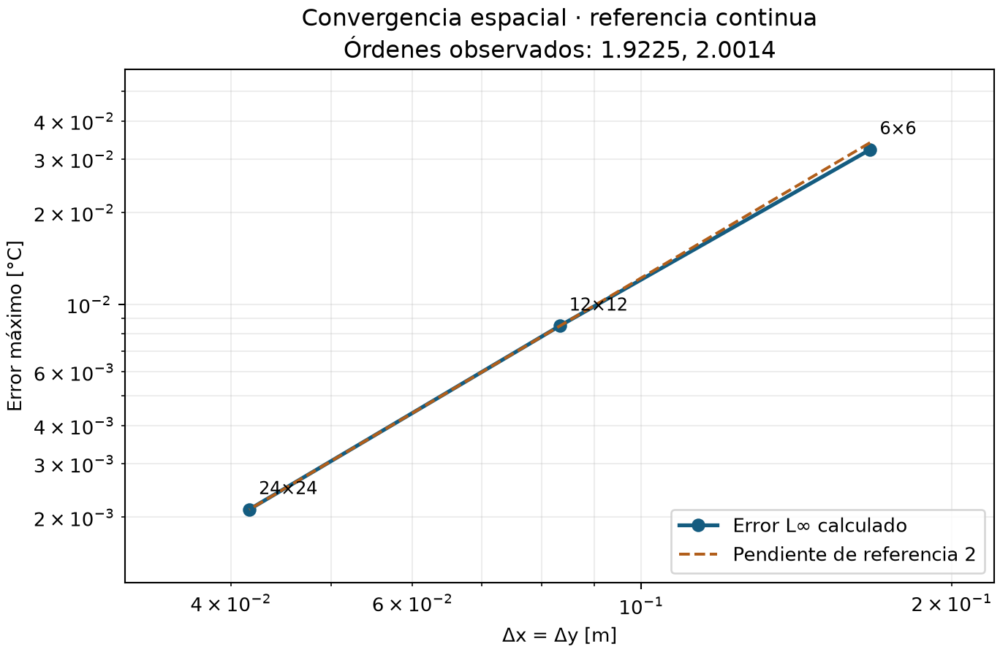
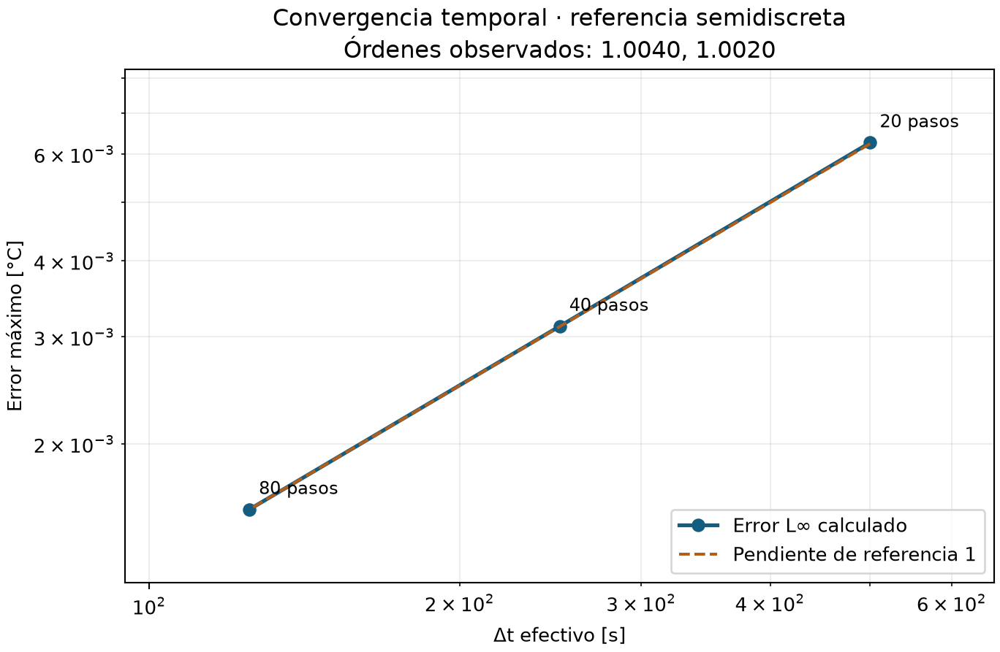
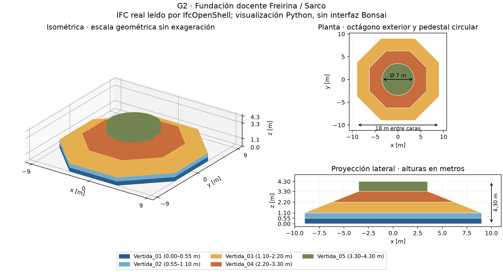

# E06 — Dossier de verificación + BIM del caso

## Repositorio y alcance

Repositorio: [amvaras/Proyecto-2-MCOC](https://github.com/amvaras/Proyecto-2-MCOC).
Commit evaluado: **COMMIT E06 PENDIENTE DE PUBLICACIÓN**

Grupo 2, Freirina / Parque Eólico Sarco. Revisión de evidencia iniciada el
2026-11-05 (UTC). Este dossier actualizado y sus cambios están locales; requieren
publicación y declaración del SHA correspondiente antes de entregar.
Los inventarios originales se conservan y las revisiones justificadas se
identifican por SHA256, sin atribuirlas al commit anterior.

Se verifica el solver básico sobre cajas ideales. El IFC documenta la geometría
constructiva docente; estos ensayos no predicen temperaturas de la fundación.
La carpeta acumulativa también contiene E07, cuyo avance de voxelización se
mantiene separado de las verificaciones térmicas presentadas aquí.

## Matriz de verificación

La ejecución aprobó **297 pruebas**, sin fallos, errores ni omisiones,
diez casos nominales y **60 variantes**. PASS exige satisfacer
referencias y tolerancias, no simplemente terminar. Los controles negativos
comprobaron el motivo y código de rechazo de estabilidad/unidades y el FAIL
por precisión insuficiente. Cada fila enlaza el resultado reproducible.

| Test | Qué verifica | Error/métrica | Resultado |
|---|---|---|---|
| [Exacta 1D](../thermal/battery/exact_1d/summary.json) | Seno continuo y Dirichlet en caras | L∞=0.000670749 °C ≤ 0.03 °C | PASS |
| [Exacta 2D](../thermal/battery/exact_2d/summary.json) | Seno continuo y Dirichlet en caras | L∞=0.00121382 °C ≤ 0.03 °C | PASS |
| [Exacta 3D](../thermal/battery/exact_3d/summary.json) | Seno continuo y Dirichlet en caras | L∞=0.00231445 °C ≤ 0.03 °C | PASS |
| [Convergencia espacial](../thermal/battery/spatial/summary.json) | Referencia continua | p=1.92254/2.00140; esperado 2±0.3 | PASS |
| [Convergencia temporal](../thermal/battery/temporal/summary.json) | Referencia semidiscreta | p=1.00403/1.00201; esperado 1±0.15 | PASS |
| [Conservación adiabática](../thermal/battery/energy/summary.json) | Capacidades heterogéneas | Residuo máximo 4.47926e-10 J ≤ 0.000308502 J | PASS |
| [Neumann](../thermal/battery/neumann/summary.json) | Flujo y balance energético | Residuo máximo 3.60887e-09 J ≤ 0.000255502 J | PASS |
| [Robin](../thermal/battery/robin/summary.json) | Flujo y balance energético | Residuo máximo 5.58794e-09 J ≤ 0.0005401 J | PASS |
| [Fuente uniforme](../thermal/battery/source/summary.json) | Pendiente y energía | Error 2.4869e-14 °C ≤ 2.46296e-10 °C | PASS |
| [Estabilidad](../thermal/battery/stability/summary.json) | Monotonía y rechazo de exceso | Paso/cota: 0.99 aceptado; 1.01 rechazado | PASS |

La referencia continua es
$$T=T_0+A\prod_j\sin(\pi x_j/L_j)\exp[-\alpha\sum_j(\pi/L_j)^2t],\quad\alpha=k/(\rho c_p).$$
Se evalúa en centros, con caras Dirichlet T₀. L∞ es el máximo error absoluto;
L2 y parámetros completos quedan en los JSON. El operador real se contrastó
con el modo y autovalor semidiscretos en 1D/2D/3D.

## Convergencia espacial

Caja 2D de 1×1 m: k=2 W/(m·K), ρ=2400 kg/m³, cₚ=900 J/(kg·K),
T₀=20 °C, A=10 °C y t=10000 s. Se fijó Δt=3.125 s.
La contaminación temporal máxima fue 2.036% del error, inferior al 10%.

| Celdas | Δx [m] | L∞ [°C] | Componente temporal [°C] |
|---|---:|---:|---:|
| 6×6 | 0.16666667 | 0.032183990 | 3.891e-05 |
| 12×12 | 0.08333333 | 0.008489825 | 4.230e-05 |
| 24×24 | 0.04166667 | 0.002120399 | 4.318e-05 |

Los cocientes 3.79089/4.00388 y órdenes de la matriz
son coherentes con segundo orden. La malla gruesa muestra efectos preasintóticos.


Figura 1. Referencia continua y paso fijo; línea auxiliar de pendiente dos.

## Convergencia temporal

Se mantuvo la malla 6×6 y se redujo únicamente Δt. La referencia exacta
semidiscreta usa decaimiento αΣⱼ4sin²(π/(2nⱼ))/Δxⱼ² para aislar el error de Euler.

| Δt efectivo [s] | Pasos | L∞ [°C] |
|---|---:|---:|
| 500.000000 | 20 | 0.006260256 |
| 250.000000 | 40 | 0.003121399 |
| 125.000000 | 80 | 0.001558527 |

Cocientes 2.00559/2.00279: primer orden temporal.
Todos los pasos cumplen la cota suficiente min(Cᵢ/ΣGᵢ), incluidas las fronteras.


Figura 2. Malla fija y referencia semidiscreta; pendiente esperada uno.

## Conservación de energía

Dominio 3D adiabático sin fuente, con perfil cosenoidal no uniforme y dos
materiales. En la segunda mitad, k, ρ y cₚ se multiplican por 3, 1,15 y 0,8.
Se integra E=ΣᵢρᵢcₚᵢVᵢ(Tᵢ−20 °C), sin sustituirla por una media aritmética.
ΔE=3.241e-10 J. El rango térmico baja de
19.49107 a 14.82510 °C: redistribución sin creación de energía.
Los intercambios internos se cancelan; la matriz registra residuo y tolerancia.

## Fuente volumétrica

Inicial uniforme, aislamiento, q̇=1000 W/m³ y duración 10000 s.
Con las propiedades anteriores, T=T_ini+q̇t/(ρcₚ): incremento esperado
4.629629630 °C y calculado 4.629629630 °C.
ΔE esperada=1e+07 J; calculada=10000000.00000005 J.
Se compararon todos los instantes guardados. W/m³ corresponde a generación
volumétrica; W/m² corresponde a flujo superficial.

## Robin

Caja 3D inicialmente a 50 °C, ambiente a 20 °C y h=12 W/(m²·K) en seis caras.
R″=Δn/(2k)+1/h y q″=(T_celda−T_ambiente)/R″: conducción de media celda y
convección en serie. La temperatura superficial difiere de centro y ambiente.
El flujo positivo saliente produce pérdida de 13455099.41544 J.
Se verificaron ley superficial, balance, máximo y sentido del intercambio;
también aprobó h=25. La suite incluye referencias transientes independientes
Robin/Neumann con otras caras, geometrías y propiedades.

## BIM base

El [IFC versionado](../../../../geometry/foundation.ifc) es IFC4 en metros, con cinco IfcFooting.
Se comprobaron jerarquía, GUID, propiedades, mallas cerradas/orientadas y diez
pares sin solapamiento volumétrico. Octágono exterior: 18 m entre caras;
borde: 1,10 m; centro: 3,30 m; pedestal: Ø7 m y altura adicional 1 m;
altura global: 4,30 m. El origen IFC es local, sin georreferenciación global.

| Vertida | Intervalo z [m] | Volumen analítico [m³] |
|---|---:|---:|
| Vertida_01 | 0.00–0.55 | 147.62571 |
| Vertida_02 | 0.55–1.10 | 147.62571 |
| Vertida_03 | 1.10–2.20 | 214.22435 |
| Vertida_04 | 2.20–3.30 | 88.92475 |
| Vertida_05 | 3.30–4.30 | 38.48451 |

Volumen analítico: 636.88504 m³; teselado: 636.87772 m³.
La diferencia procede del círculo teselado; tolerancia relativa por pieza: 5e-4.
La reconstrucción conservó geometría, identidad y propiedades del IFC original.


Figura 3. IFC real, visualizado con Python/IfcOpenShell; no es captura de Bonsai.

## Simplificaciones geométricas

- Octágono idealizado y espesores docentes; no reconstrucción experimental exacta.
- Borde 1,10 m y pedestal adicional 1 m adoptados para el ejercicio.
- Transición inclinada mediante dos troncos octagonales planos.
- Cinco vertidas iniciales, sin optimización del plan constructivo.
- Armaduras, pernos, anclajes y detalles menores omitidos.
- Origen local sin georreferencia global IFC.

## Reproducibilidad

Instalar Python 3.12 y dependencias según [README](../../../../README.md); se incluyen
24 ruedas para instalación sin red. Desde P2_E07, con ese entorno activo:

```powershell
python scripts/verify_e06.py --output results/e06_nuevo
python scripts/check_ifc.py geometry/foundation.ifc
python scripts/create_preliminary_ifc.py --output results/fundacion_nueva.ifc
```

Usar destinos nuevos. El generador protege el IFC existente. Bonsai permite
abrirlo y seleccionar Vertida_01–05. [Evidencia](../e06.json): versiones, comandos,
parámetros, criterios, hashes y comprobación documental. La ejecución técnica
está verificada; falta publicar y declarar el nuevo commit evaluado.
