# E09 — Baseline 3D con hidratación
Grupo 2 · MCOC, Universidad de los Andes · 6 de noviembre de 2026.

## Repositorio y alcance
Repositorio: [amvaras/Proyecto-2-MCOC](https://github.com/amvaras/Proyecto-2-MCOC).
Commit evaluado: [entrega-e09](https://github.com/amvaras/Proyecto-2-MCOC/commit/entrega-e09)

Se simula la fundación docente del Parque Eólico Sarco, Freirina, durante
14 días completos. Las coordenadas climáticas de referencia son
−28,856102; −71,421831, pero no se utilizaron registros meteorológicos.
Es un baseline numérico interpretable, no una predicción calibrada de obra.

## BIM, grilla y error geométrico
El [IFC real](../geometry/foundation.ifc) contiene cinco IfcFooting,
con GUID y propiedades conservados. Se verifican metros, transformaciones,
mallas cerradas y cotas. La planta octagonal mide 18 m entre caras; borde
1,10 m, centro 3,30 m y pedestal Ø7 m con 1 m adicional: altura total 4,30 m.
La imagen representa sus triángulos originales con IfcOpenShell; no es una captura de Bonsai.

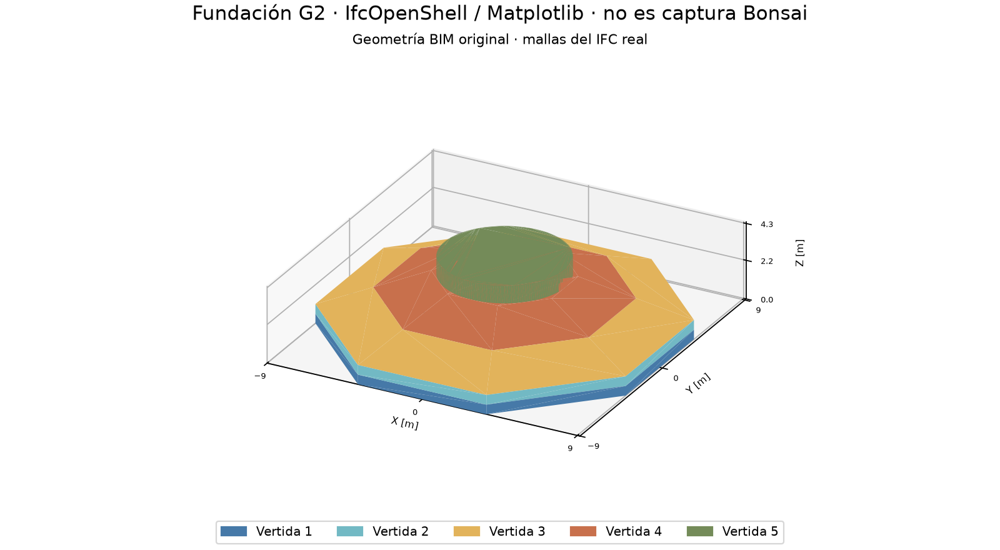

Una celda se ocupa si su centro pertenece al sólido; la caja envolvente solo
acelera la clasificación. Se utilizan pasos 0.275 ×
0.275 × 0.1375 m,
139,392 celdas totales y 60,892 ocupadas.
El volumen calculado es 633.181656 m³, frente a
636.877718 m³ teselados: diferencia absoluta
3.696061 m³, error 0.58034%.
La referencia analítica docente es 636,885036 m³.

Por vertida, volumen y error respecto del IFC: V1: 146.493 m³ (0.77%); V2: 146.493 m³ (0.77%); V3: 214.520 m³ (0.14%); V4: 88.844 m³ (0.09%); V5: 36.831 m³ (4.28%).
El error global no oculta el del pedestal. El estudio cúbico usa 0,55,
0,275 y 0,1375 m; su error oscila por alineamiento. La frontera staircase
también sesga el área expuesta. Esta resolución permite completar la duración;
no demuestra convergencia espacial del campo térmico real.

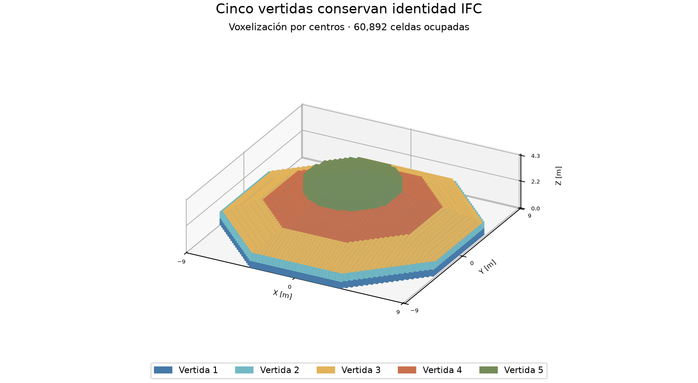
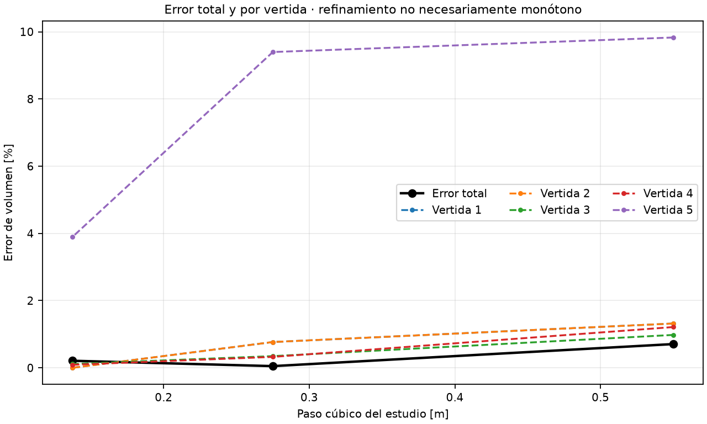

## Vertidas, hidratación y ambiente
Calendario ilustrativo, editable en JSON: V1: 0 h/18 °C, V2: 5 h/19 °C, V3: 10 h/20 °C, V4: 15 h/21 °C, V5: 20 h/22 °C. Las cotas
son 0–0,55; 0,55–1,10; 1,10–2,20; 2,20–3,30 y 3,30–4,30 m.
Antes de colocarse, una vertida no aporta capacidad, conducción ni fuente.
La colocación inicializa únicamente sus celdas y reinicia su propia edad.
Dos vertidas activas intercambian calor con contacto perfecto; frente a una
futura, la cara existente queda expuesta. La visibilidad gráfica no altera esto.

Se adoptan k=2 W/(m·K), rho=2400 kg/m³ y
cp=900 J/(kg·K). Para edad a y duración tau,
xi=[1−cos(pi·clip(a/tau,0,1))]/2 y q_h=H_vol·d(xi)/dt, en W/m³.
H_vol=64.8 MJ/m³ y tau=48 h
equivalen a 30 K adiabáticos con esta capacidad. Son hipótesis, no ensayos;
no existe Arrhenius. Se integra exactamente el calor liberado por intervalo.

Las caras superiores y laterales expuestas usan Robin, ambiente constante
20 °C y h=8 W/(m²·K). La base z− es adiabática:
representa aislamiento ideal, sin suelo explícito. Las interfaces activas no reciben Robin.

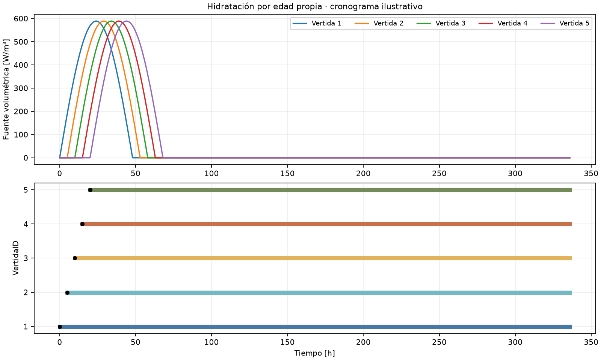

## Integración y resultados
El balance por celda activa es C_i·dT_i/dt=sum G_ij(T_j−T_i)+q_h·V−P_salida,
con C_i=rho·cp·V y resistencias de media celda en los contactos y Robin.
Euler explícito ejecutó 1344 pasos de
900 s y guardó 116 campos.
La mínima cota local fue 6806.25 s;
max(dt/cota)=0.1322, inferior a safety=0.8.
Al reducir el paso a 450 s, la diferencia máxima de campos fue 0.02116 °C; el pico cambió -0.00452 °C. Es sensibilidad temporal, no error exacto.

El máximo, registrado en todos los pasos, fue 51.4805 °C a
66 h, en V5 y coordenadas (-0.062, -0.062, 3.369) m.
El control sin hidratación alcanzó 22.00 °C.
El calentamiento procede de la fuente; después domina la disipación, mientras
la base aislada conserva calor y recibe redistribución desde otras capas.

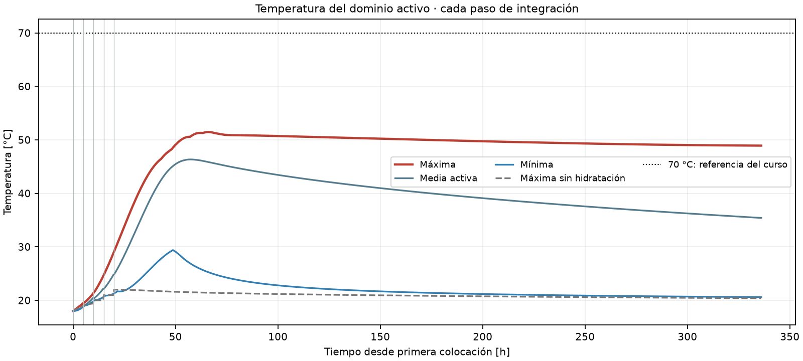

La sonda núcleo es el centro ocupado más cercano a (0,0,1,65) m.
La cara superior queda en la misma línea vertical; se reconstruye mediante
Ts=(Tc+h·dn/(2k)·Ta)/(1+h·dn/(2k)), no se confunde con el centro.
La sonda lateral es la cara x+ más cercana al objetivo exterior; sus coordenadas
y las de cada centro de vertida están en summary.json. La sonda basal
usa el centro ocupado inferior de la línea central.

Máximos de núcleo/superior/lateral/base:
50.253/33.829/29.358/48.923 °C;
ocurren a 57.75/61.5/48.25/329.5 h.
No se comparan como si tuvieran igual edad desde colocación.
La diferencia núcleo–cara superior alcanza 24.3426 °C a
287.5 h; solo se evalúa cuando existen ambas sondas.
El máximo no supera 70 °C, pero el diferencial supera 20 °C.
Esto identifica una observación del baseline, sin certificar seguridad constructiva.

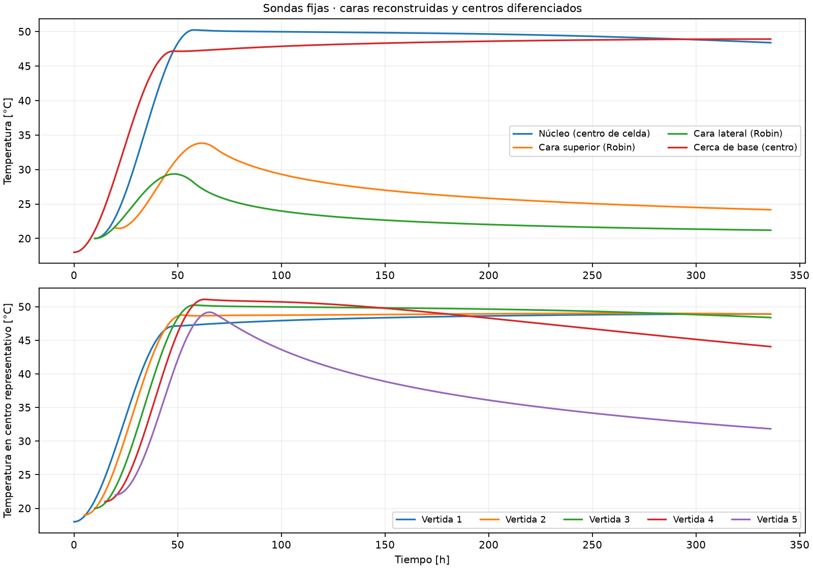
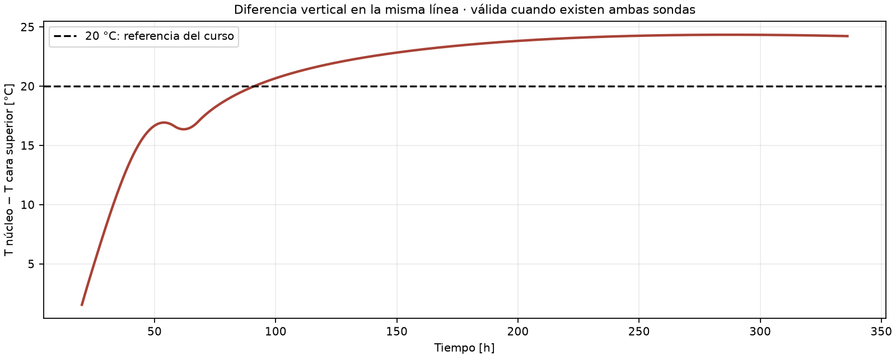

## Evolución espacial y energía
Los cortes revelan interior caliente y enfriamiento exterior. La lámina usa
la misma orientación y escala térmica; gris significa vertida futura, blanco
vacío. El seccionamiento es solo visual. La continuidad conductiva redistribuye
calor entre vertidas, mientras cada una conserva su edad de hidratación.

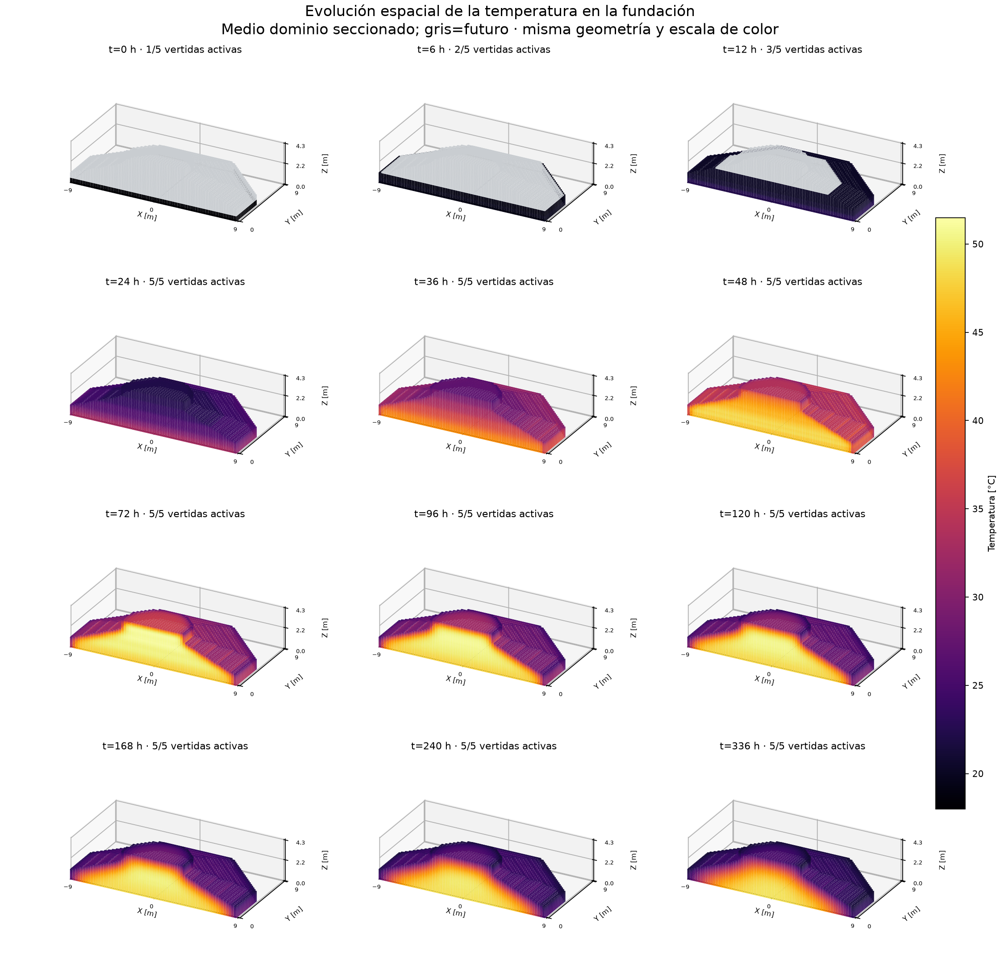
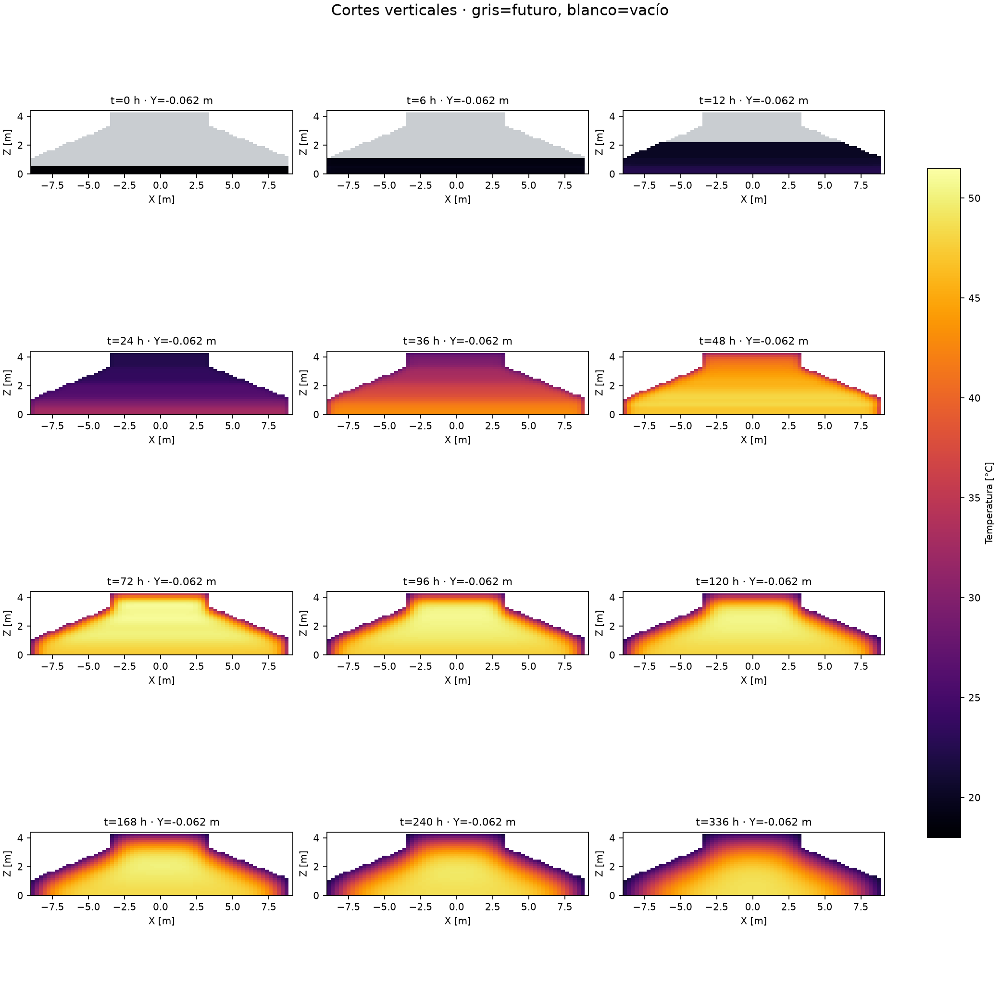
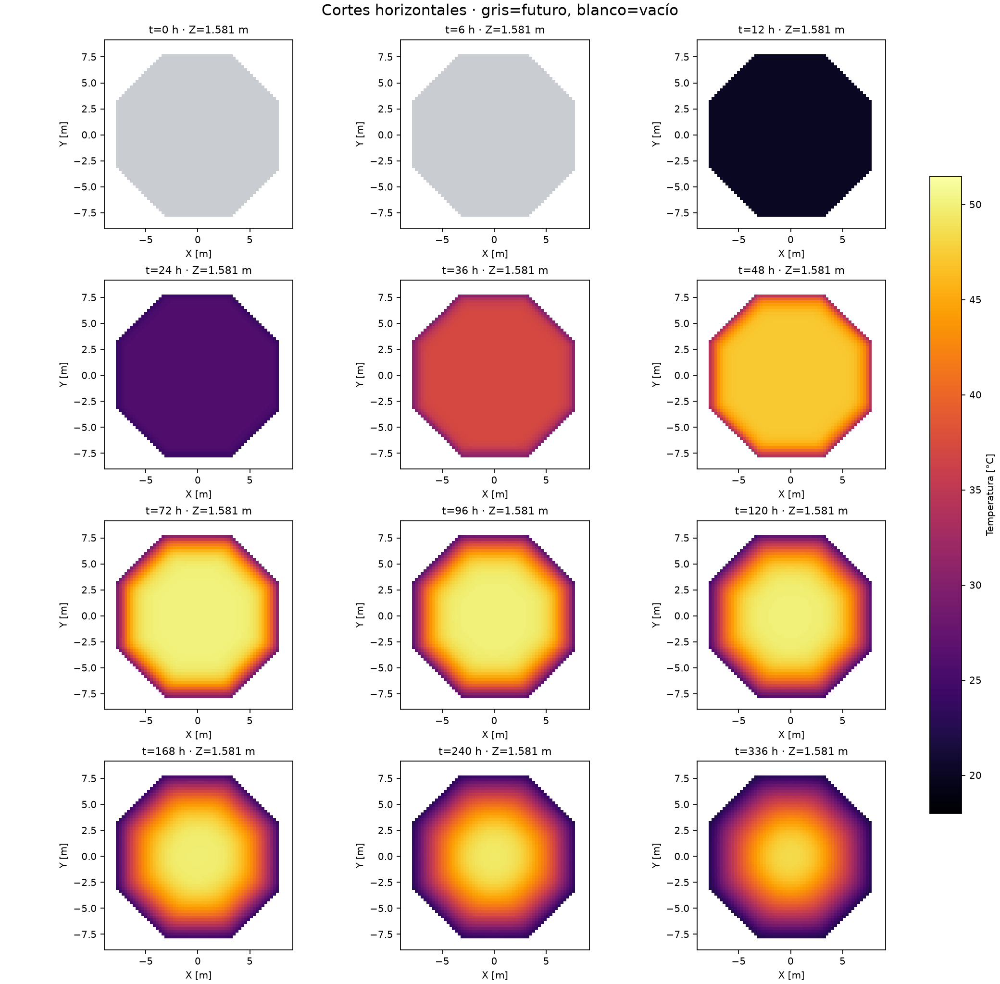

Con referencia energética de 20 °C, hidratación:
41.03017 GJ; salida neta:
19.34973 GJ; entrada posterior:
0.03459 GJ. Se comprueba
DeltaE=Q_h−Q_salida+E_colocación, por etapa y globalmente.
Residuo global -1.15e-05 J, frente a tolerancia
0.411 J; no se atribuye la energía entrante a hidratación.

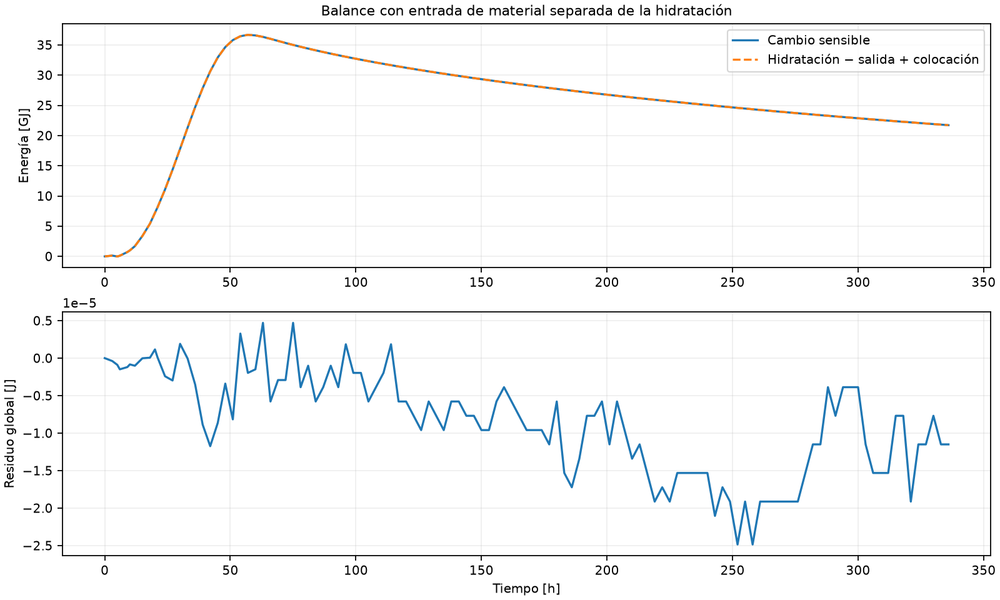

## Comparación crítica con Ju y Lei
Referencia: Ju, Y. y Lei, H. (2019), *Actual Temperature Evolution of Thick Raft
Concrete Foundations and Cracking Risk Analysis*, Advances in Materials Science
and Engineering, 7029671. [Artículo original](https://doi.org/10.1155/2019/7029671).

**Qué reproduce.** El interior se calienta por hidratación, alcanza un pico
y luego se enfría. La superficie permanece más fría y la base retiene calor.
Son tendencias también observadas en la fundación 1 (sección 3.1).

**Qué no reproduce.** Ju y Lei midieron cerca de 73 °C en el núcleo al
cuarto día y una diferencia núcleo–superficie de 35 °C al noveno día. Nuestra
sonda de núcleo alcanza 50.25 °C a 57.75 h
y el diferencial alcanza 24.34 °C a 287.5 h.
El pico global del modelo está en el pedestal. El terreno del artículo
permite que la base se enfríe lentamente. Aquí se aísla y la sonda basal
alcanza su máximo cerca del final. El ensayo adiabático, la edad equivalente,
el clima variable y la evaluación de fisuras quedan fuera de esta comparación.

## Reproducibilidad y límites
Desde esta carpeta, instalar con scripts/install.ps1; ejecutar
examples/run_e09.py, scripts/plot_e09.py, scripts/build_e09_dossier.py y
scripts/verify_e09.py, según [README](../README.md).
Los [arrays y métricas](../results/e09_baseline/summary.json) conservan configuración,
máscaras, coordenadas, sondas, pasos y balances. Las figuras registran el SHA
del campo utilizado; se verifica el límite de palabras y todos los enlaces.
Faltan calibración, clima y suelo reales, convergencia espacial de esta fundación
y validación experimental. El siguiente uso debe estudiar sensibilidad y fronteras
antes de proponer decisiones constructivas.
