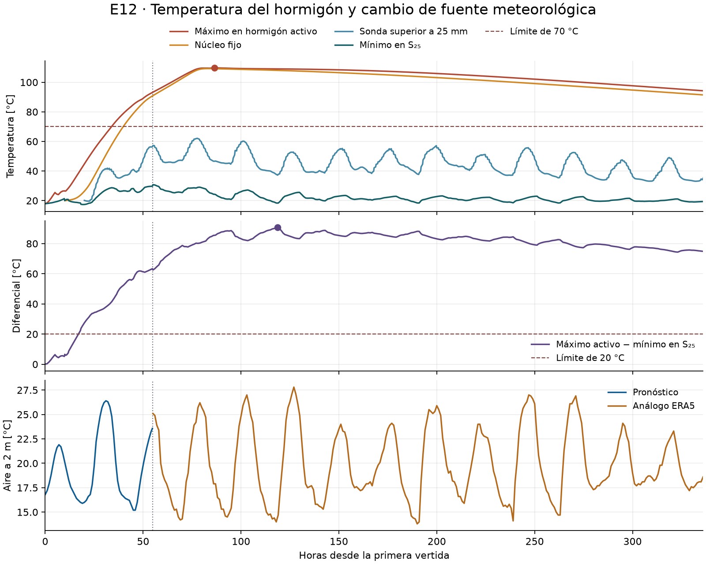
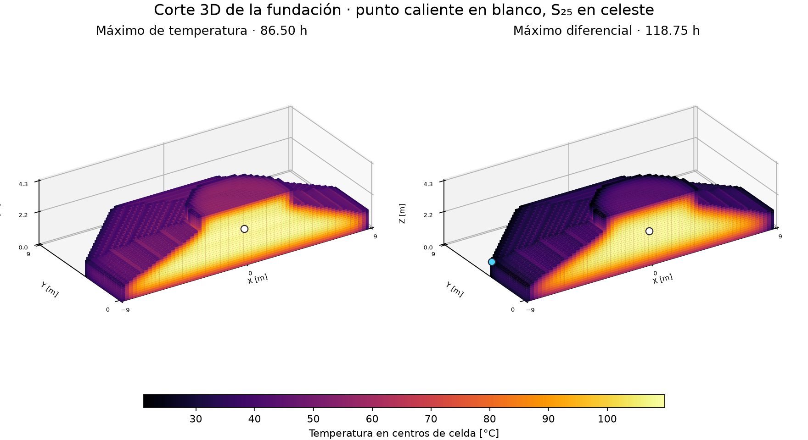

# E12 · Simulación determinista de 14 días

Grupo 2 · Caso docente Freirina / Parque Eólico Sarco

Repositorio: [amvaras/Proyecto-2-MCOC](https://github.com/amvaras/Proyecto-2-MCOC)

Commit evaluado: [entrega-e12](https://github.com/amvaras/Proyecto-2-MCOC/commit/entrega-e12)

## Caso y fuente de calor

Se simulan 336 h desde el 27/11/2026 a las 08:00 hasta el 11/12/2026 a las
08:00, hora de Chile continental (UTC−03). Se usa el IFC del curso
(-28,856102°, -71,421831° como punto meteorológico). Se ocupan 60.892
vóxeles de 0,275 × 0,275 × 0,1375 m. El volumen voxelizado es 633,18 m³,
con un error de 0,580 % respecto de la malla IFC. El material homogéneo
tiene k = 2 W/(m·K), ρ = 2.400 kg/m³ y cₚ = 900 J/(kg·K).
[IFC](../P2_E11/geometry/foundation.ifc) · [Configuración](config.json)

Se eligió **M4, campaña 22 de abril de 2025**, porque la fuente aún
es positiva pero ya es pequeña al final del registro (2,105 W/m³).
Se usa la misma columna `M4_22A_W_m3` en las cinco vertidas. Se asigna
el inicio de la ventana retenida a la colocación. El archivo arranca
dos horas después del inicio del registro, por lo que esta alineación
es un supuesto. La fuente depende de la edad de cada vertida y se
integra por tramos lineales en W/m³. Después de la última muestra válida,
a las 163,02 h de edad, se usa fuente cero. El calor acumulado es
191,70 MJ/m³, equivalente a una elevación adiabática de 88,75 °C con
la capacidad adoptada. La curva proviene de probetas del curso.
[Archivo docente](data/source_terms.txt)

## Clima y condiciones de borde

El pronóstico horario Open-Meteo se descargó el **13/11/2026 a las
21:17:42 de Chile** (14/11, 00:17:42 UTC). Dentro de la simulación cubre
**55 h**, hasta el 29/11 a las 15:00 de Chile. El archivo original
preserva cinco filas finales incompletas. La simulación usa el tramo
continuo con las tres variables y sin huecos.
[Consulta y SHA-256](data/weather/forecast/request.json) · [JSON original](data/weather/forecast/weather.json)

Las **281 h restantes** se completan con un análogo meteorológico
determinista de ERA5, del 29/11/2025 a las 15:00 al 11/12/2025 a las 08:00
de Chile. Se descargó el 13/11/2026 a las 21:17:41 de Chile. Se conserva
la hora del día al trasladar los datos un año y se cambia de fuente a
las 55 h, con un empalme directo. Temperatura a 2 m y viento a 10 m
se interpolan linealmente. La radiación horizontal GHI usa el promedio
de la hora que termina en el sello del proveedor.
[ERA5 y SHA-256](data/weather/era5-2025/metadata.json) · [Documentación del proveedor](https://open-meteo.com/en/docs/historical-weather-api)

| Zona | Condición y parámetros |
| --- | --- |
| Caras al aire | Robin con T del aire y h = 5 + 4v₁₀ en W/(m²·K), con v₁₀ en m/s. |
| Horizontales hacia arriba | Robin y onda corta absorbida: α·GHI, α = 0,55. |
| Laterales exteriores | Tablero de 18 mm y k = 0,13, más aislación de 25 mm y k = 0,04 W/(m·K). R total 0,7635 m²·K/W hasta 18,25 h. Desde entonces aplica Robin directo. |
| Base en contacto con suelo | Reservorio a 18 °C, 0,4 m de suelo con k = 1,5 W/(m·K) y R de contacto 0,025 m²·K/W. |
| Entre vertidas activas | Conducción con contacto perfecto. Las caras hacia una futura vertida quedan expuestas al aire hasta activarla. |

El desmolde afecta a las caras laterales que ya estaban protegidas.
La V5 se coloca después del retiro programado y entra expuesta.

## Plan de vertidas

| Vertida | Hora de inicio [h] | Temperatura al colocar [°C] |
| --- | ---: | ---: |
| V1 | 0 | 18 |
| V2 | 5 | 19 |
| V3 | 10 | 20 |
| V4 | 15 | 21 |
| V5 | 20 | 22 |

## Evaluación determinista

Se evalúan los 1.344 pasos de 900 s y el estado inicial. En cada instante
se toma el máximo del hormigón activo y se resta el mínimo de S₂₅ en ese
mismo estado. S₂₅ muestrea el centro de cada cara exterior activa a 25 mm
hacia el interior, reconstruido desde el centro del vóxel mediante
`T₂₅ = T_c − q_saliente (Δn/2 − 0,025)/k`. Se trata de una reconstrucción
lineal local sobre la frontera voxelizada. La sonda fija del gráfico
muestra la evolución del núcleo cerca de (0, 0, 1,65) m y del punto
superior a 25 mm, a medida que se activan sus celdas.

| Criterio | Máximo | Instante desde V1 y hora de Chile | Ubicación XYZ [m] |
| --- | ---: | --- | --- |
| Tmáx ≤ 70 °C | **109,76 °C** | 86,50 h · 30/11 a las 22:30 | V4 (−0,063, −0,063, 2,406) |
| ΔTmáx ≤ 20 °C | **90,69 °C** | 118,75 h · 02/12 a las 06:45 | V4 (−0,063, −0,063, 2,269), 109,04 °C. Lateral de V2 (−8,975, 3,788, 1,031), 18,34 °C. |





**El plan incumple ambos criterios con la curva y el clima seleccionados.**
El diferencial es la primera restricción activa, a las 17 h. El límite
de temperatura se supera a las 34 h. La hidratación acumula calor en el
interior, mientras el lateral expuesto pierde calor hacia el aire.
En el máximo diferencial el aire está a 14,53 °C, la radiación horizontal
es 3 W/m² y el núcleo caliente sigue a 109,04 °C. El contraste entre
retención interna y enfriamiento superficial controla el resultado.
Ambos límites ya se excedían durante las 55 h cubiertas por el pronóstico.

## Reproducción

En el entorno de [E11](../P2_E11/README.md), desde la raíz:

```powershell
$env:PYTHONPATH = (Resolve-Path 'P2_E11/src').Path
python -X utf8 -B P2_E12/run.py --output results/e12_repeticion
python -X utf8 -B P2_E12/plot.py results/e12_repeticion
```

El balance cierra con residuo de 0,000031 J y tolerancia de 1,21 J.
Con 450 s, Tmáx cambia −0,0054 °C y ΔTmáx −0,0172 °C. El punto frío
se desplaza a un lateral equivalente por simetría de la grilla.
La verificación reduce el paso en la misma malla. Los resultados dependen
de la curva de probeta, la grilla y el escenario meteorológico elegido.
[Resumen](evidencia/summary.json) · [Series](evidencia/series.csv) · [Sensibilidad](evidencia/sensibilidad_paso.json)
